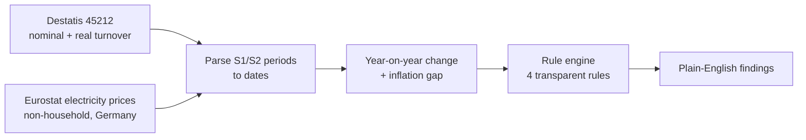

# German Business Data Autopsy

**Is German retail actually growing, or is it inflation?** This project puts official Destatis turnover data next to Eurostat business electricity prices and runs a small, transparent rule engine that turns the numbers into plain-English findings.

---

## Findings

Turnover index for German motor trade and retail (Destatis 45212, 2015 = 100), second half of each year:

| | H2 2015 | H2 2020 | H2 2024 | Change 2015 → 2024 |
|---|---|---|---|---|
| Nominal turnover (current prices) | 103.2 | 129.5 | 149.3 | **+44.7 %** |
| Real turnover (constant prices) | 103.2 | 122.3 | 117.8 | **+14.1 %** |
| Gap (price effect, index points) | 0.0 | 7.2 | **31.5** | |

- **Most of the "growth" since 2020 is prices.** Between H2 2020 and H2 2024 nominal turnover rose 15.3 % while real turnover *fell* 3.7 %.
- **Energy costs rose at the same time.** Business electricity (Eurostat band IC, 500–2,000 MWh a year) went from €0.089 to €0.201 per kWh before taxes (+127 %), and from €0.218 to €0.283 with all taxes and levies (+30 %), H2 2020 → H2 2024.
- **Two real demand shocks:** real turnover dropped 8.0 % year on year in H1 2021 and 14.6 % in H2 2021.

### What the rule engine flags

Run over the 9 half-years where both datasets overlap (H2 2020 – H2 2024), it produces 8 findings:

| Period | Finding |
|---|---|
| H2 2020 | Healthy growth: real demand up 6.4 % with low energy costs |
| H1 2021, H2 2021 | Demand shock: real turnover down more than 5 % |
| H1 2023 | Illusory growth: nominal up, real flat |
| H2 2023, H1 2024 | Illusory growth **and** margin pressure: real sales slipping while electricity is above its period average |

Two flags in the same half-year mean the pressures stack up.

---

## How it works



The four rules in `src/insight_engine.py`:

| Rule | Fires when |
|---|---|
| Margin pressure | real YoY change < 0 **and** electricity price above its average |
| Illusory growth | inflation gap above its average **and** real YoY change ≤ 0 |
| Healthy growth | real YoY change > 3 % **and** electricity price at or below average |
| Demand shock | real YoY change < −5 % |

**Why rules and not a model?** With 9 overlapping half-years there is nothing to train on honestly, and every flag can be traced back to a number a manager can check.

---

## Run it

```bash
git clone https://github.com/dubeykrish0307/GermanBusinessDataAutopsy.git
cd GermanBusinessDataAutopsy
python -m venv venv && source venv/bin/activate
pip install -r requirements.txt notebook
jupyter notebook
```

Run `notebook/02_energy_data_ingestion.ipynb` first (it writes `Data/processed/energy_price_index.csv`), then `notebook/01_data_ingestion.ipynb`, which merges both datasets and runs the rule engine.

```
Data/
├── Raw/
│   ├── DESTATIS-45212BH002 time series.csv
│   └── energy_prices_non_household.csv
└── processed/energy_price_index.csv
notebook/
├── 01_data_ingestion.ipynb
└── 02_energy_data_ingestion.ipynb
src/insight_engine.py
```

**Sources:** [Destatis GENESIS table 45212](https://www-genesis.destatis.de/) (retail turnover, half-yearly) · [Eurostat nrg_pc_205](https://ec.europa.eu/eurostat/databrowser/view/nrg_pc_205/default/table) (electricity prices for non-household consumers)

---

## Known limitations and next steps

- [ ] The notebooks read `../data/raw/…` but the folder is `Data/Raw/`. That works on macOS but fails on Linux and Colab. Rename the folders to lower case.
- [ ] The electricity series is a price in €/kWh averaged across tax treatments and currency units (including purchasing-power standard), not an index. Pick one (before taxes is the cleanest cost signal) and rename the column.
- [ ] The turnover series includes motor trade. Re-run on pure retail (WZ08-47), which is in the same Destatis file.
- [ ] Add wage costs and a severity score for each flag.

---

**Krish Dubey**, B.Sc. Computer Science student at SRH Munich · [LinkedIn](https://www.linkedin.com/in/dubeykrish) · [GitHub](https://github.com/dubeykrish0307)
